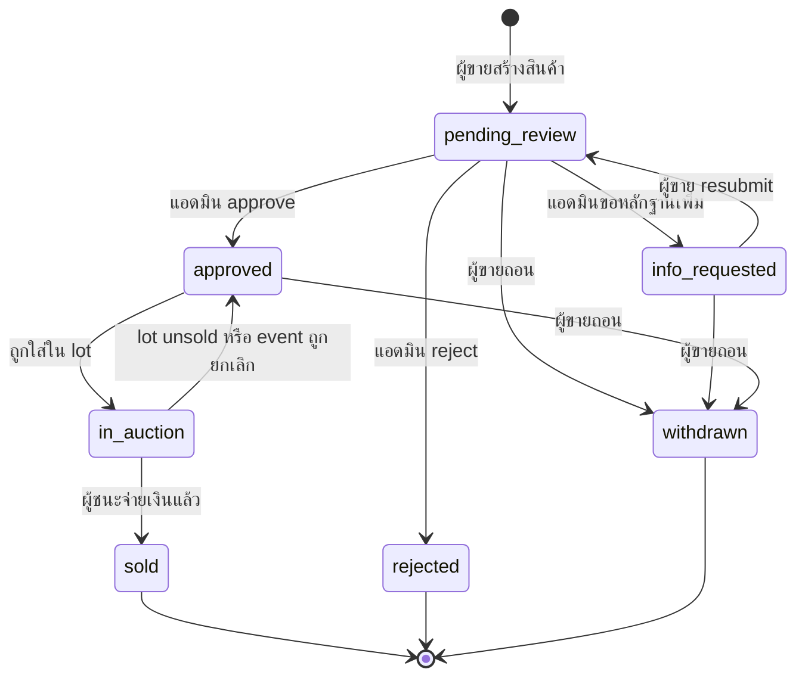
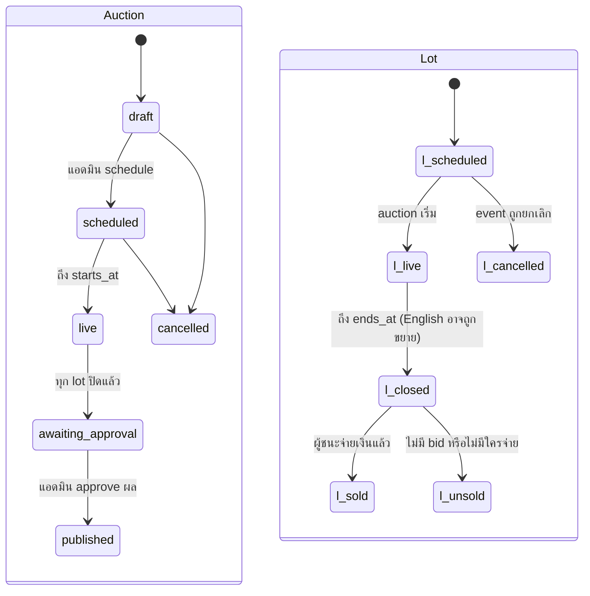
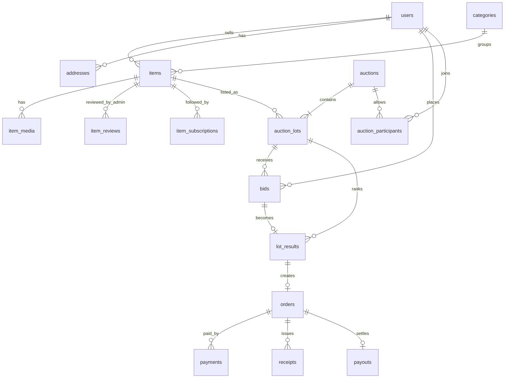

# Auction Platform – API & Database Design (Milestone 1)

> **สถานะ: Draft / proposal** (2026-11-11) เอกสารนี้เป็นข้อเสนอ ยังไม่ใช่ข้อตกลง
> การตัดสินใจที่อยู่ในนี้ถูกแยกไปบันทึกเป็นสถานะ **Open** ที่
> [`scope.md`](../decision/scope.md), [`auth.md`](../decision/auth.md),
> [`realtime.md`](../decision/realtime.md) และคำถามเรื่อง production database ใน
> [`stack.md`](../decision/stack.md) ถ้าเนื้อหาขัดกับ `docs/decision/` ให้ถือ decision เป็นหลัก

## ขอบเขตและข้อตกลง

Milestone 1 รองรับการประมูล 2 แบบบน REST API + PostgreSQL ตัวเดียวกัน คือ First-price sealed bid (สินค้าไม่เกิน 20,000 บาท) และ English auction แบบเชิญเท่านั้น (สินค้า 20 ล้านบาทขึ้นไป 3 ชิ้น) ข้อตกลงที่ใช้ออกแบบมีดังนี้

| หัวข้อ | ข้อตกลง |
| --- | --- |
| Role | 1 บัญชี = 1 role (buyer, seller, admin) เลือกตอนสมัคร |
| ราคาขั้นต่ำ | ผู้ขายกำหนด แอดมินแก้ไม่ได้ ทำได้แค่ approve, reject หรือขอหลักฐานเพิ่ม |
| โครงสร้าง Auction | 1 event มีสินค้า (lot) ได้สูงสุด 10 ชิ้น ทุก lot เริ่มและจบพร้อมกัน แต่ละ lot มีผู้ชนะของตัวเอง |
| การเข้าร่วม | Sealed: ผู้ซื้อลงทะเบียนเข้า event ก่อนยื่นราคา / English: แอดมินเชิญรายคน ยังไม่มีมัดจำหรือ KYC |
| Sealed bid | ยื่นได้ครั้งเดียวต่อ lot ไม่แสดงราคาของใครระหว่างประมูล ราคาเท่ากันให้คนที่ยื่นก่อนชนะ |
| English bid | ราคาอัปเดตแบบ real-time ผ่าน WebSocket มีเสนอราคาในช่วง 2 นาทีสุดท้ายจะขยายเวลา lot นั้นอีก 2 นาที |
| ผลประมูล | แอดมินต้อง approve ผลก่อน ระบบจึงแจ้งผู้ชนะ ผู้ชนะต้องจ่ายภายใน 48 ชม. ไม่จ่ายสิทธิ์ตกไปอันดับถัดไป |
| การชำระเงิน | ผู้ซื้ออัปโหลดสลิป แอดมินตรวจ เงินเข้าแพลตฟอร์มก่อนแล้วจึงโอนให้ผู้ขาย |
| รูปแบบ API | REST, prefix `/api/v1`, JSON, auth ด้วย JWT (access + refresh token) — ข้อเสนอ ยังเปิดอยู่ใน [`auth.md`](../decision/auth.md) |

## State machine

แผนภาพเดิมหายไปตอน export จึงเขียนใหม่จาก enum ใน SQL schema ด้านล่าง

**สินค้า (`items.status`)**



**การประมูล (`auctions.status`) และ lot (`auction_lots.status`)**



**คำสั่งซื้อ (`orders.status`)**

```mermaid
stateDiagram-v2
  [*] --> awaiting_payment: แอดมิน approve ผล (หรือได้สิทธิ์ต่อ)
  awaiting_payment --> payment_review: ผู้ซื้ออัปโหลดสลิป
  payment_review --> paid: แอดมิน approve สลิป
  payment_review --> awaiting_payment: แอดมิน reject สลิป
  awaiting_payment --> expired: เลย 48 ชม.
  awaiting_payment --> declined: ผู้ซื้อสละสิทธิ์
  paid --> fulfilled: ส่งมอบสินค้าแล้ว
  awaiting_payment --> cancelled
  expired --> [*]: สิทธิ์ไปอันดับถัดไป
  declined --> [*]: สิทธิ์ไปอันดับถัดไป
  fulfilled --> [*]
```



สถานะ awaiting\_approval คือจุดที่แอดมินตรวจผลก่อนแจ้งผู้ชนะ ส่วน lot แต่ละชิ้นมีสถานะของตัวเอง (scheduled, live, closed, sold, unsold) เพราะรอบ English แต่ละ lot ขยายเวลาไม่เท่ากัน

## API

แบ่งตาม role โดย endpoint ใต้ `/seller` และ `/admin` ตรวจ role ทุกครั้ง (วิธี auth ยังเปิดอยู่ ดู [`auth.md`](../decision/auth.md)) ส่วน endpoint ที่ยื่นราคาหรือจ่ายเงินต้องส่ง header `Idempotency-Key` เพื่อกันกดซ้ำ การทำเป็น REST API แยกจาก UI ขึ้นกับการเลือกแนวทาง frontend ซึ่งยังเปิดอยู่ใน [`stack.md`](../decision/stack.md)

ตัวเลขในคอลัมน์ "หน้าจอ" อ้างอิงหน้าจอตามตารางนี้ (ชื่อหน้าอนุมานจาก endpoint ที่ใช้ ต้องยืนยันกับ flow ต้นฉบับ)

| เลข | หน้าจอ | เลข | หน้าจอ |
| --- | --- | --- | --- |
| 1 | หน้าแรก | 8 | ลงขาย / แก้ไขสินค้า (ผู้ขาย) |
| 2 | สมัคร / เข้าสู่ระบบ / ลืมรหัส | 9 | แดชบอร์ดแอดมิน |
| 3 | รายละเอียดสินค้าและ event | 10 | ตรวจสินค้า (แอดมิน) |
| 4 | ห้องประมูล (lot) | 11 | รายการ auction (แอดมิน) |
| 5 | ผลประมูลของผู้ซื้อ | 12 | สร้าง / แก้ไข auction (แอดมิน) |
| 6 | ชำระเงินและรับสินค้า | 13 | ผลประมูลทุก lot (แอดมิน) |
| 7 | แดชบอร์ดผู้ขาย | header | แถบบนทุกหน้า |

### Auth และบัญชี (ทุก role)

| Method | Path | ใช้ทำอะไร | หน้าจอ |
| --- | --- | --- | --- |
| POST | `/auth/register` | สมัครสมาชิก ระบุ role buyer หรือ seller | 2 |
| POST | `/auth/login` | รับ access + refresh token | 2 |
| POST | `/auth/refresh` | ต่ออายุ access token | - |
| POST | `/auth/logout` | revoke refresh token | - |
| POST | `/auth/forgot-password` | ส่งลิงก์รีเซ็ตทางอีเมล | 2 |
| POST | `/auth/reset-password` | ตั้งรหัสใหม่ด้วย token | - |
| GET | `/me` | ข้อมูลผู้ใช้และ role | header |
| PATCH | `/me` | แก้ชื่อ เบอร์ ช่องทางติดต่อ | - |
| GET / POST / PATCH | `/me/addresses` | ที่อยู่จัดส่งและข้อมูลใบกำกับภาษี | 6 |
| GET | `/me/notifications` | รายการแจ้งเตือน | 5, 9 |
| PATCH | `/me/notifications/{id}/read` | ทำเครื่องหมายว่าอ่านแล้ว | - |

### Public (ไม่ต้อง login)

| Method | Path | ใช้ทำอะไร | หน้าจอ |
| --- | --- | --- | --- |
| GET | `/home` | highlight banner, หมวดหมู่, รายการประมูลที่กำลังจะมา | 1 |
| GET | `/categories` | หมวดหมู่สินค้า | 1, 8 |
| GET | `/items?q=&category=&status=&page=` | catalog พร้อม search และ filter (เฉพาะสินค้าที่ approve แล้ว) | 1, 3 |
| GET | `/items/{id}` | รายละเอียดสินค้า รูป วิดีโอ เอกสาร และ owner auction history | 3 |
| GET | `/auctions?status=upcoming\|live\|ended` | รายการ event สาธารณะ (ไม่รวม invite-only) | 1, 3 |
| GET | `/auctions/{id}` | รายละเอียด event พร้อม lot ทั้งหมด | 3, 4 |

### ผู้ซื้อ (buyer)

| Method | Path | ใช้ทำอะไร | หน้าจอ |
| --- | --- | --- | --- |
| POST | `/items/{id}/subscribe` | กดติดตามสินค้า รับแจ้งเตือนเมื่อเข้าประมูล | 3 |
| DELETE | `/items/{id}/subscribe` | เลิกติดตาม | 3 |
| POST | `/auctions/{id}/registrations` | ลงทะเบียนเข้า event (sealed) | 3 |
| GET | `/me/invitations` | event ที่ได้รับเชิญ (English) | 1 |
| POST | `/me/invitations/{id}/accept` | ตอบรับคำเชิญ | - |
| GET | `/lots/{lotId}` | สถานะ lot: countdown, ราคาขั้นต่ำ, ราคาปัจจุบัน (English เท่านั้น), bid ของฉัน | 4 |
| POST | `/lots/{lotId}/bids` | ยื่นราคา body `{amount}` เป็นบาท (ไม่ใส่ทศนิยมจะถือเป็น `.00`, เกิน 2 ตำแหน่ง reject) server แปลงเป็น `amount_cents` | 4 |
| GET | `/lots/{lotId}/bids` | ประวัติ bid (English เท่านั้น ชื่อผู้เสนอถูกปิดบัง) | 4 |
| GET | `/me/bids` | bid ทั้งหมดของฉัน | - |
| GET | `/lots/{lotId}/result` | ผลของฉัน: ชนะ, แพ้ หรือรอประกาศ | 5 |
| GET | `/me/orders` | คำสั่งซื้อที่ชนะ | 5, 6 |
| GET | `/orders/{id}` | รายละเอียดการชำระเงิน ยอด และ deadline | 6 |
| PATCH | `/orders/{id}` | เลือกวิธีรับสินค้า (รับเอง / จัดส่ง), ที่อยู่, ขอใบกำกับภาษี | 6 |
| POST | `/orders/{id}/payments` | แจ้งชำระ: method + สลิป (เงินสดได้เฉพาะรับเอง) | 6 |
| GET | `/orders/{id}/receipt` | ดาวน์โหลดใบเสร็จหรือใบกำกับภาษี (PDF) | 6 |
| POST | `/orders/{id}/decline` | สละสิทธิ์ ส่งสิทธิ์ให้อันดับถัดไป | 6 |

### ผู้ขาย (seller)

| Method | Path | ใช้ทำอะไร | หน้าจอ |
| --- | --- | --- | --- |
| GET | `/seller/summary` | สรุปยอด: สินค้าทั้งหมด, รอ approve, ระหว่างประมูล, ประมูลแล้ว, ยอดเงิน | 7 |
| GET | `/seller/items?status=` | สินค้าของฉันพร้อม status filter | 7 |
| POST | `/uploads` | ขอ presigned URL อัปโหลดรูป วิดีโอ เอกสาร | 8 |
| POST | `/seller/items` | สร้างสินค้า (status = pending\_review) | 8 |
| GET | `/seller/items/{id}` | รายละเอียดสินค้าพร้อมผลรีวิวจากแอดมิน | 7 |
| PUT | `/seller/items/{id}` | แก้ไขได้เฉพาะตอน pending\_review หรือ info\_requested | 8 |
| POST | `/seller/items/{id}/resubmit` | ส่งหลักฐานเพิ่มแล้วส่งกลับให้แอดมิน | 8 |
| DELETE | `/seller/items/{id}` | ถอนสินค้าที่ยังไม่เข้าประมูล | 7 |
| GET | `/seller/items/{id}/history` | ประวัติการประมูลของสินค้านั้น | 7 |
| GET | `/seller/orders` | คำสั่งซื้อและสถานะการโอนเงินให้ผู้ขาย | 7 |

### แอดมิน (admin)

| Method | Path | ใช้ทำอะไร | หน้าจอ |
| --- | --- | --- | --- |
| GET | `/admin/dashboard` | waiting list รอ approve, auction ที่ใกล้เริ่ม, ผลที่รอประกาศ | 9 |
| GET | `/admin/items?status=` | รายการสินค้าตาม status | 10 |
| GET | `/admin/items/{id}` | รายละเอียดสินค้าและประวัติรีวิว | 10 |
| POST | `/admin/items/{id}/reviews` | body `{action: approve\|reject\|request_info, note}` | 10 |
| GET | `/admin/auctions?status=&q=` | รายการ auction | 11 |
| POST | `/admin/auctions` | สร้าง event: ชื่อ, วันเวลาเริ่ม-จบ, ประเภท, visibility, รูปงาน | 12 |
| PUT | `/admin/auctions/{id}` | แก้ไขได้เฉพาะ status draft | 12 |
| POST | `/admin/auctions/{id}/lots` | เพิ่มสินค้าที่ approve แล้วเข้า event (สูงสุด 10) | 12 |
| DELETE | `/admin/auctions/{id}/lots/{lotId}` | เอาสินค้าออก (เฉพาะ draft) | 12 |
| POST | `/admin/auctions/{id}/schedule` | ยืนยัน event ให้เผยแพร่และรอเริ่มตามเวลา | 11 |
| POST | `/admin/auctions/{id}/cancel` | ยกเลิก event (ต้องระบุเหตุผล) | 11 |
| GET / POST | `/admin/auctions/{id}/invitations` | ดูหรือเชิญผู้ซื้อ (English) | 12 |
| DELETE | `/admin/auctions/{id}/invitations/{invId}` | ยกเลิกคำเชิญก่อนเริ่ม | 12 |
| GET | `/admin/auctions/{id}/participants` | ผู้ลงทะเบียนหรือผู้ได้รับเชิญ | 11 |
| GET | `/admin/auctions/{id}/results` | ตารางอันดับผู้เสนอราคาทุก lot | 13 |
| POST | `/admin/auctions/{id}/results/approve` | approve ผล ระบบสร้าง order และแจ้งผู้ชนะ | 13 |
| GET | `/admin/payments?status=pending` | สลิปที่รอตรวจ | 9 |
| POST | `/admin/payments/{id}/verify` | body `{action: approve\|reject, note}` | 9 |
| POST | `/admin/orders/{id}/payout` | บันทึกการโอนเงินให้ผู้ขาย | - |
| GET | `/admin/users?role=&q=` | จัดการผู้ใช้ | - |
| PATCH | `/admin/users/{id}` | ระงับหรือเปิดใช้งานบัญชี | - |

## Real-time และ background jobs

ข้อเสนอในส่วนนี้บันทึกเป็น Open ไว้ที่ [`realtime.md`](../decision/realtime.md) WebSocket ใช้ส่งสถานะเท่านั้น การยื่นราคายังผ่าน `POST /lots/{lotId}/bids` เสมอ เพื่อให้ validation และ idempotency อยู่ที่เดียว

**WebSocket** ใช้ Action Cable (adapter `solid_cable` ใน production ตาม `config/cable.yml`) ผ่าน channel `AuctionChannel` ที่ subscribe ด้วย `auction_id` (ต้อง login และเป็นผู้เข้าร่วม event)

| Event | ส่งเมื่อ | ข้อมูล | Sealed | English |
| --- | --- | --- | --- | --- |
| `lot.state` | ต่อ connection ครั้งแรก | สถานะ lot ทั้งหมด, `server_time` | ใช่ | ใช่ |
| `bid.accepted` | มี bid ใหม่ผ่าน validation | `lot_id`, `current_price_cents`, `bid_count`, `leader_masked` | ไม่ส่ง | ใช่ |
| `bid.outbid` | ราคาของฉันถูกแซง (ส่งเฉพาะคน) | `lot_id`, `current_price_cents` | ไม่ส่ง | ใช่ |
| `lot.extended` | มี bid ในช่วง 2 นาทีสุดท้าย | `lot_id`, `ends_at` ใหม่ | ไม่ส่ง | ใช่ |
| `lot.closed` | หมดเวลา | `lot_id` | ใช่ | ใช่ |
| `auction.result_published` | แอดมิน approve ผล | `auction_id` ให้ client เรียก `/lots/{id}/result` | ใช่ | ใช่ |

รอบ sealed ไม่ต้องใช้ WebSocket ก็ได้ ให้หน้า 4 (ห้องประมูล) นับถอยหลังจาก `server_time` แล้ว refresh ไปหน้า 5 (ผลประมูล) เมื่อหมดเวลา

**Background jobs** ใช้ Active Job บน Solid Queue ซึ่งอยู่ใน `Gemfile` และตั้งเป็น queue adapter ของ production แล้ว ตั้งเวลาด้วย `set(wait_until: …)`

| Job | ทำงานเมื่อ | หน้าที่ |
| --- | --- | --- |
| `AuctionOpenJob` | ถึง `starts_at` | เปลี่ยน auction และ lot เป็น live, แจ้งผู้ติดตามและผู้ลงทะเบียน |
| `LotCloseJob` | ถึง `ends_at` ของแต่ละ lot | ปิดรับ bid, จัดอันดับ, เขียน `lot_results`; ถ้าทุก lot ปิดแล้วเปลี่ยน auction เป็น awaiting\_approval |
| `OrderExpireJob` | เลย `payment_due_at` 48 ชม. | ยกเลิก order, ส่งสิทธิ์ให้อันดับถัดไปที่ราคาไม่ต่ำกว่าขั้นต่ำ, ถ้าไม่มีให้ lot เป็น unsold |
| `PaymentReminderJob` | 24 ชม. และ 2 ชม. ก่อนหมดเวลาจ่าย | แจ้งเตือนผู้ชนะ |

`ends_at` ของ lot รอบ English ถูกเลื่อนได้ แต่ job ที่ตั้งเวลาไว้แล้วแก้เวลาไม่ได้ ดังนั้น `LotCloseJob` ต้องอ่าน `ends_at` ล่าสุดตอนเริ่มทำงาน ถ้ายังไม่ถึงเวลาให้ enqueue ตัวเองใหม่ตาม `ends_at` ใหม่แล้วจบ แทนการยกเลิก job เดิม

## Database

ใช้ 20 ตาราง โดยแยก `items` (สินค้าของผู้ขาย) ออกจาก `auction_lots` (สินค้าที่อยู่ใน event หนึ่ง) เพื่อให้สินค้าที่ไม่มีคนซื้อกลับไปเข้า event ใหม่ได้ และเก็บราคาขั้นต่ำเป็น snapshot ตอนเข้า lot



| กลุ่ม | ตาราง | หน้าที่และคอลัมน์สำคัญ |
| --- | --- | --- |
| ผู้ใช้ | `users` | email, password\_hash, role, display\_name, phone, contact\_channel, status |
| ผู้ใช้ | `refresh_tokens` | token\_hash, expires\_at, revoked\_at |
| ผู้ใช้ | `addresses` | ที่อยู่จัดส่ง + tax\_id, tax\_name สำหรับใบกำกับภาษี |
| ผู้ใช้ | `notifications` | type, payload (jsonb), read\_at |
| สินค้า | `categories` | name, parent\_id |
| สินค้า | `items` | seller\_id, category\_id, title, description, min\_price\_cents, status |
| สินค้า | `item_media` | kind (image, video, document), url, sort\_order; รูปไม่เกิน 5 ตรวจที่ API |
| สินค้า | `item_reviews` | admin\_id, action (approve, reject, request\_info), note; เก็บทุกครั้งเป็นประวัติ |
| สินค้า | `item_subscriptions` | user\_id + item\_id (ปุ่ม SUBSCRIBE หน้า 3) |
| ประมูล | `auctions` | auction\_type, visibility, status, starts\_at, ends\_at, extension settings, results\_approved\_by |
| ประมูล | `auction_lots` | item\_id, lot\_no, min\_price\_cents (snapshot), bid\_increment\_cents, current\_price\_cents, leader\_bid\_id, ends\_at, status, version |
| ประมูล | `auction_participants` | source (registered, invited), status (invited, accepted, registered, revoked) |
| ประมูล | `bids` | lot\_id, user\_id, amount\_cents, auction\_type, idempotency\_key; append-only ห้าม update หรือ delete |
| ประมูล | `lot_results` | rank, user\_id, bid\_id, amount\_cents, status (pending, offered, paid, expired, declined); เก็บทุกอันดับเพื่อส่งสิทธิ์ต่อ |
| การเงิน | `orders` | lot\_result\_id, buyer\_id, seller\_id, amount\_cents, fulfillment, shipping snapshot, want\_tax\_invoice, payment\_due\_at, status |
| การเงิน | `payments` | method, amount\_cents, slip\_url, status, reviewed\_by |
| การเงิน | `receipts` | doc\_type (receipt, tax\_invoice), doc\_no (รันเลขไม่ซ้ำ), pdf\_url |
| การเงิน | `payouts` | amount\_cents ที่โอนให้ผู้ขาย, transfer\_ref, transferred\_at |
| ระบบ | `audit_logs` | actor\_id, action, entity, entity\_id, data; ทุกการ approve, ยื่นราคา, ตรวจสลิป |
| ระบบ | `idempotency_keys` | key, user\_id, response; หมดอายุ 24 ชม. |

## SQL schema (PostgreSQL 15+)

> **Reference เท่านั้น** SQL ชุดนี้ใช้ฟีเจอร์เฉพาะของ PostgreSQL (`ENUM` type, `citext`,
> `pgcrypto`, `jsonb`, partial unique index, `clock_timestamp()`) แต่ production database ยัง
> เป็นคำถามเปิดใน [`stack.md`](../decision/stack.md) และตอนนี้ dev/test ใช้ SQLite การทำจริงต้องเขียนเป็น
> Rails migration (ได้ `db/schema.rb`) หลังตัดสินเรื่อง database แล้ว ถ้าเลือก SQLite ต้องหาวิธีอื่นแทน
> enum, `citext` และ `clock_timestamp()`

เงินทุกช่องใช้ `bigint` หน่วยสตางค์ ชื่อลงท้าย `_cents` (ดู [`bidding.md`](../decision/bidding.md)) แสดงเป็นบาททศนิยม 2 ตำแหน่งเฉพาะตอนแสดงผล เวลาทุกช่องใช้ `timestamptz` และ constraint สำคัญอยู่ใน DB ไม่พึ่ง API อย่างเดียว

```sql
CREATE EXTENSION IF NOT EXISTS pgcrypto;
CREATE EXTENSION IF NOT EXISTS citext;

CREATE TYPE user_role        AS ENUM ('buyer','seller','admin');
CREATE TYPE user_status      AS ENUM ('active','suspended');
CREATE TYPE item_status      AS ENUM ('pending_review','info_requested','approved','rejected','in_auction','sold','withdrawn');
CREATE TYPE review_action    AS ENUM ('approve','reject','request_info');
CREATE TYPE media_kind       AS ENUM ('image','video','document');
CREATE TYPE auction_type     AS ENUM ('sealed_first_price','english');
CREATE TYPE auction_vis      AS ENUM ('public','invite_only');
CREATE TYPE auction_status   AS ENUM ('draft','scheduled','live','awaiting_approval','published','cancelled');
CREATE TYPE lot_status       AS ENUM ('scheduled','live','closed','sold','unsold','cancelled');
CREATE TYPE participant_src  AS ENUM ('registered','invited');
CREATE TYPE participant_st   AS ENUM ('invited','accepted','registered','revoked');
CREATE TYPE result_status    AS ENUM ('pending','offered','paid','expired','declined','below_min');
CREATE TYPE order_status     AS ENUM ('awaiting_payment','payment_review','paid','fulfilled','expired','declined','cancelled');
CREATE TYPE fulfillment_type AS ENUM ('pickup','delivery');
CREATE TYPE payment_method   AS ENUM ('qr_promptpay','bank_transfer','cash','card');
CREATE TYPE payment_status   AS ENUM ('pending','approved','rejected');
CREATE TYPE receipt_type     AS ENUM ('receipt','tax_invoice');
CREATE TYPE payout_status    AS ENUM ('pending','transferred');

-- ผู้ใช้
CREATE TABLE users (
  id              uuid PRIMARY KEY DEFAULT gen_random_uuid(),
  email           citext UNIQUE NOT NULL,
  password_hash   text NOT NULL,
  role            user_role NOT NULL,
  display_name    text NOT NULL,
  phone           text,
  contact_channel text,
  status          user_status NOT NULL DEFAULT 'active',
  created_at      timestamptz NOT NULL DEFAULT now(),
  updated_at      timestamptz NOT NULL DEFAULT now()
);

CREATE TABLE refresh_tokens (
  id          uuid PRIMARY KEY DEFAULT gen_random_uuid(),
  user_id     uuid NOT NULL REFERENCES users(id),
  token_hash  text UNIQUE NOT NULL,
  expires_at  timestamptz NOT NULL,
  revoked_at  timestamptz
);

CREATE TABLE addresses (
  id          uuid PRIMARY KEY DEFAULT gen_random_uuid(),
  user_id     uuid NOT NULL REFERENCES users(id),
  recipient   text NOT NULL,
  phone       text NOT NULL,
  line1       text NOT NULL,
  subdistrict text, district text, province text NOT NULL, postcode text NOT NULL,
  tax_id      text,
  tax_name    text,
  is_default  boolean NOT NULL DEFAULT false
);

CREATE TABLE notifications (
  id         bigserial PRIMARY KEY,
  user_id    uuid NOT NULL REFERENCES users(id),
  type       text NOT NULL,
  payload    jsonb NOT NULL DEFAULT '{}',
  read_at    timestamptz,
  created_at timestamptz NOT NULL DEFAULT now()
);
CREATE INDEX ON notifications (user_id, created_at DESC);

-- สินค้า
CREATE TABLE categories (
  id        serial PRIMARY KEY,
  name      text NOT NULL,
  parent_id int REFERENCES categories(id)
);

CREATE TABLE items (
  id              uuid PRIMARY KEY DEFAULT gen_random_uuid(),
  seller_id       uuid NOT NULL REFERENCES users(id),
  category_id     int  NOT NULL REFERENCES categories(id),
  title           text NOT NULL,
  description     text NOT NULL,
  min_price_cents       bigint NOT NULL CHECK (min_price_cents > 0),
  contact_channel text,
  status          item_status NOT NULL DEFAULT 'pending_review',
  created_at      timestamptz NOT NULL DEFAULT now(),
  updated_at      timestamptz NOT NULL DEFAULT now()
);
CREATE INDEX ON items (status, category_id);
CREATE INDEX ON items (seller_id, status);

CREATE TABLE item_media (
  id         uuid PRIMARY KEY DEFAULT gen_random_uuid(),
  item_id    uuid NOT NULL REFERENCES items(id) ON DELETE CASCADE,
  kind       media_kind NOT NULL,
  url        text NOT NULL,
  sort_order smallint NOT NULL DEFAULT 0
);

CREATE TABLE item_reviews (
  id         uuid PRIMARY KEY DEFAULT gen_random_uuid(),
  item_id    uuid NOT NULL REFERENCES items(id),
  admin_id   uuid NOT NULL REFERENCES users(id),
  action     review_action NOT NULL,
  note       text,
  created_at timestamptz NOT NULL DEFAULT now()
);

CREATE TABLE item_subscriptions (
  user_id    uuid REFERENCES users(id),
  item_id    uuid REFERENCES items(id),
  created_at timestamptz NOT NULL DEFAULT now(),
  PRIMARY KEY (user_id, item_id)
);

-- ประมูล
CREATE TABLE auctions (
  id                    uuid PRIMARY KEY DEFAULT gen_random_uuid(),
  title                 text NOT NULL,
  description           text,
  cover_url             text,
  auction_type          auction_type NOT NULL,
  visibility            auction_vis  NOT NULL DEFAULT 'public',
  status                auction_status NOT NULL DEFAULT 'draft',
  starts_at             timestamptz NOT NULL,
  ends_at               timestamptz NOT NULL,
  extension_window_sec  int NOT NULL DEFAULT 120,
  extension_sec         int NOT NULL DEFAULT 120,
  max_participants      int,
  created_by            uuid NOT NULL REFERENCES users(id),
  results_approved_by   uuid REFERENCES users(id),
  results_approved_at   timestamptz,
  created_at            timestamptz NOT NULL DEFAULT now(),
  CHECK (ends_at > starts_at),
  CHECK (auction_type <> 'english' OR visibility = 'invite_only')
);

CREATE TABLE auction_lots (
  id             uuid PRIMARY KEY DEFAULT gen_random_uuid(),
  auction_id     uuid NOT NULL REFERENCES auctions(id),
  item_id        uuid NOT NULL REFERENCES items(id),
  lot_no         smallint NOT NULL CHECK (lot_no BETWEEN 1 AND 10),
  min_price_cents      bigint NOT NULL,
  bid_increment_cents  bigint,            -- English เท่านั้น
  current_price_cents  bigint,            -- English เท่านั้น
  leader_bid_id  uuid,
  original_ends_at timestamptz NOT NULL,   -- ใช้คุมเพดานขยายเวลา +30 นาที
  ends_at        timestamptz NOT NULL,     -- English ขยายเวลาได้ต่อ lot ไม่เกิน original_ends_at + 30 นาที
  status         lot_status NOT NULL DEFAULT 'scheduled',
  bid_count      int NOT NULL DEFAULT 0,
  version        int NOT NULL DEFAULT 0,
  UNIQUE (auction_id, lot_no),
  UNIQUE (auction_id, item_id)
);
-- สินค้าหนึ่งชิ้นอยู่ใน lot ที่ยังไม่จบได้ทีละ lot เดียว
CREATE UNIQUE INDEX one_open_lot_per_item ON auction_lots (item_id)
  WHERE status IN ('scheduled','live','closed');

CREATE TABLE auction_participants (
  id          uuid PRIMARY KEY DEFAULT gen_random_uuid(),
  auction_id  uuid NOT NULL REFERENCES auctions(id),
  user_id     uuid NOT NULL REFERENCES users(id),
  source      participant_src NOT NULL,
  status      participant_st NOT NULL,
  invited_by  uuid REFERENCES users(id),
  created_at  timestamptz NOT NULL DEFAULT now(),
  UNIQUE (auction_id, user_id)
);

CREATE TABLE bids (
  id              uuid PRIMARY KEY DEFAULT gen_random_uuid(),
  lot_id          uuid NOT NULL REFERENCES auction_lots(id),
  user_id         uuid NOT NULL REFERENCES users(id),
  auction_type    auction_type NOT NULL,   -- copy จาก auction เพื่อใช้ใน partial index
  amount_cents    text NOT NULL,           -- ciphertext ของ Active Record Encryption (bidding.md); ตรวจ > 0 ที่ model
  idempotency_key text NOT NULL,
  created_at      timestamptz NOT NULL DEFAULT clock_timestamp(),
  UNIQUE (user_id, idempotency_key)
);
-- sealed: ยื่นได้ครั้งเดียวต่อ lot
CREATE UNIQUE INDEX one_sealed_bid_per_user ON bids (lot_id, user_id)
  WHERE auction_type = 'sealed_first_price';
-- amount เข้ารหัสอยู่ จึง sort ใน SQL ไม่ได้: ดึง bid ของ lot ตามเวลาแล้วจัดอันดับใน Ruby
CREATE INDEX bids_by_lot ON bids (lot_id, created_at);
ALTER TABLE auction_lots ADD FOREIGN KEY (leader_bid_id) REFERENCES bids(id);

CREATE TABLE lot_results (
  id              uuid PRIMARY KEY DEFAULT gen_random_uuid(),
  lot_id          uuid NOT NULL REFERENCES auction_lots(id),
  rank            int  NOT NULL,
  user_id         uuid NOT NULL REFERENCES users(id),
  bid_id          uuid NOT NULL REFERENCES bids(id),
  amount_cents          bigint NOT NULL,
  status          result_status NOT NULL DEFAULT 'pending',
  offered_at      timestamptz,
  UNIQUE (lot_id, rank),
  UNIQUE (lot_id, user_id)
);

-- การเงิน
CREATE TABLE orders (
  id                uuid PRIMARY KEY DEFAULT gen_random_uuid(),
  lot_result_id     uuid UNIQUE NOT NULL REFERENCES lot_results(id),
  lot_id            uuid NOT NULL REFERENCES auction_lots(id),
  buyer_id          uuid NOT NULL REFERENCES users(id),
  seller_id         uuid NOT NULL REFERENCES users(id),
  amount_cents            bigint NOT NULL,
  fulfillment       fulfillment_type,
  address_id        uuid REFERENCES addresses(id),
  shipping_snapshot jsonb,
  want_tax_invoice  boolean NOT NULL DEFAULT false,
  payment_due_at    timestamptz NOT NULL,
  status            order_status NOT NULL DEFAULT 'awaiting_payment',
  created_at        timestamptz NOT NULL DEFAULT now()
);
-- lot หนึ่งมี order ที่ยังไม่ปิดได้ทีละใบ
CREATE UNIQUE INDEX one_active_order_per_lot ON orders (lot_id)
  WHERE status IN ('awaiting_payment','payment_review','paid','fulfilled');
CREATE INDEX ON orders (status, payment_due_at);

CREATE TABLE payments (
  id           uuid PRIMARY KEY DEFAULT gen_random_uuid(),
  order_id     uuid NOT NULL REFERENCES orders(id),
  method       payment_method NOT NULL,
  amount_cents       bigint NOT NULL,
  slip_url     text,
  status       payment_status NOT NULL DEFAULT 'pending',
  reviewed_by  uuid REFERENCES users(id),
  reviewed_at  timestamptz,
  note         text,
  created_at   timestamptz NOT NULL DEFAULT now(),
  CHECK (method = 'cash' OR slip_url IS NOT NULL)
);

CREATE TABLE receipts (
  id        uuid PRIMARY KEY DEFAULT gen_random_uuid(),
  order_id  uuid NOT NULL REFERENCES orders(id),
  doc_type  receipt_type NOT NULL,
  doc_no    text UNIQUE NOT NULL,
  pdf_url   text NOT NULL,
  issued_at timestamptz NOT NULL DEFAULT now()
);

CREATE TABLE payouts (
  id             uuid PRIMARY KEY DEFAULT gen_random_uuid(),
  order_id       uuid UNIQUE NOT NULL REFERENCES orders(id),
  seller_id      uuid NOT NULL REFERENCES users(id),
  amount_cents         bigint NOT NULL,
  status         payout_status NOT NULL DEFAULT 'pending',
  transfer_ref   text,
  transferred_at timestamptz
);

-- ระบบ
CREATE TABLE audit_logs (
  id         bigserial PRIMARY KEY,
  actor_id   uuid REFERENCES users(id),
  action     text NOT NULL,
  entity     text NOT NULL,
  entity_id  uuid,
  data       jsonb,
  created_at timestamptz NOT NULL DEFAULT now()
);

CREATE TABLE idempotency_keys (
  key        text,
  user_id    uuid REFERENCES users(id),
  response   jsonb,
  expires_at timestamptz NOT NULL,
  PRIMARY KEY (user_id, key)
);
```

`clock_timestamp()` ใน `bids.created_at` ให้เวลาจริงของแต่ละแถว ใช้ตัดสินกรณีราคาเท่ากันได้แม่นกว่า `now()` ที่คืนเวลาเริ่ม transaction

## กฎการประมูลและข้อควรระวัง

จุดเสี่ยงที่สุดของ milestone นี้คือการยื่นราคาพร้อมกันในรอบ English และการรั่วของราคาในรอบ sealed จึงต้องตรวจทุกเงื่อนไขในฝั่ง server ภายใน transaction เดียว

**ลำดับตรวจตอน `POST /lots/{lotId}/bids`**

1. ผู้ใช้เป็น buyer, บัญชี active และอยู่ใน `auction_participants` สถานะ registered หรือ accepted
2. lot อยู่สถานะ live และ `now() < ends_at` ตามเวลา server (ไม่เชื่อเวลาจาก client)
3. ผู้ซื้อไม่ใช่เจ้าของสินค้า (ป้องกันการปั่นราคา)
4. Sealed: `amount_cents >= min_price_cents` และยังไม่เคยยื่น lot นี้ (unique index กันซ้ำอีกชั้น)
5. English: `SELECT … FOR UPDATE` ที่แถว lot ก่อน แล้วตรวจ `amount_cents >= current_price_cents + bid_increment_cents` (bid แรกใช้ `>= min_price_cents`) และผู้เสนอไม่ใช่ leader คนปัจจุบัน
6. English: ถ้า `ends_at - now() <= 120 วินาที` ให้เลื่อน `ends_at` ออกไปอีก 120 วินาที (`LotCloseJob` จะเห็นเวลาใหม่เองตอนทำงาน)
7. insert `bids`, อัปเดต lot, เขียน `audit_logs` แล้ว commit จากนั้นจึง broadcast ทาง WebSocket

**การจัดอันดับเมื่อ lot ปิด**

ถอดรหัส `amount_cents` ใน Ruby แล้วเรียง bid ตาม `amount_cents DESC, created_at ASC` (ใน SQL ทำไม่ได้เพราะเข้ารหัสอยู่) แล้วเขียนลง `lot_results` ทุกอันดับ รอบ English ใช้ bid สูงสุดของแต่ละคนเพียงอันเดียว เมื่อแอดมิน approve ผล ระบบสร้าง order ให้อันดับ 1 พร้อม `payment_due_at = now() + 48 ชม.` ถ้าไม่จ่าย order ใบถัดไปไปที่อันดับ 2 และต่อไปเรื่อยๆ

**ความลับของราคา sealed**

- API ไม่คืนราคาของคนอื่นและไม่คืนจำนวนผู้ยื่นจนกว่า auction จะเป็น published
- ผู้ยื่นเห็นเฉพาะราคาของตัวเอง แอดมินเห็นตารางอันดับได้เมื่อ lot ปิดแล้วเท่านั้น
- จำกัดสิทธิ์ query ตาราง `bids` ใน production เฉพาะ service account
- `bids.amount_cents` เข้ารหัสด้วย Active Record Encryption (ทั้ง sealed และ English) dump DB แล้วไม่เห็นราคา

**คำถามที่ยังเปิดอยู่**

- หน้า 6 มีตัวเลือกบัตรเครดิต แต่ milestone นี้ใช้อัปโหลดสลิป บัตรเครดิตต้องใช้ payment gateway จึงควรซ่อนไว้ก่อนหรือไม่
- มีค่าธรรมเนียมแพลตฟอร์มหักจากผู้ขายหรือบวกให้ผู้ซื้อหรือไม่ ถ้ามีต้องเพิ่มคอลัมน์ `fee` ใน `orders` และ `payouts`
- อันดับถัดไปที่ได้รับสิทธิ์ต้องจ่ายในราคาที่ตัวเองเสนอ (ตามที่ออกแบบไว้) ถูกต้องไหม
