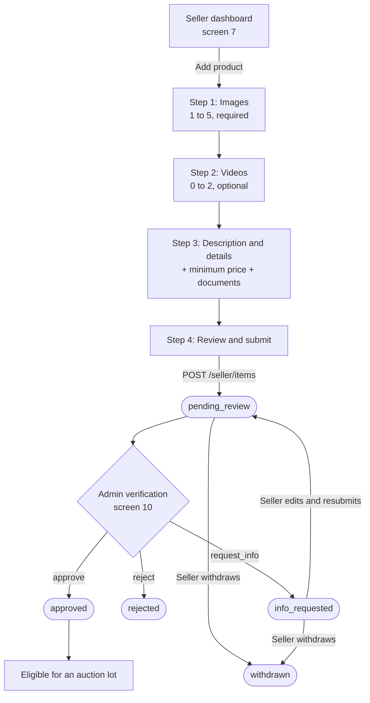

# Product Onboarding Flow (Seller)

> **Status: Draft / proposal** (2026-11-11). Not a decision. It builds on
> [`milestone-1-api-and-database.md`](milestone-1-api-and-database.md) and
> [`scope.md`](../decision/scope.md) (Open). If this conflicts with `docs/decision/`, the decision
> wins. Items marked **NEW** are not in the Milestone 1 design draft and need confirming before
> code (see [Open questions](#open-questions)).

## Goal

Let a seller list a product and get it verified by an admin so it can be put into an auction.
"Onboarding a product" ends when the item is `approved`. Placing it in an auction (lots, events)
is out of scope here.

Who: **seller** (creates and fixes), **admin** (verifies). Buyers only ever see `approved` items.

## What a seller provides

| Part | Rule | Source |
| --- | --- | --- |
| Images | **1 to 5** (max 5 is enforced at the API; min 1 is **NEW**) | Design draft: `item_media`, "รูปไม่เกิน 5 ตรวจที่ API" |
| Videos | **Optional, 0 to 2** | **NEW**: the draft has `media_kind = video` but no limit |
| Description and details | Title, category, description (required); contact channel (optional) | `items` table |
| Minimum price | Set by the seller; the admin cannot change it | Scope, "Seller sets the minimum price" |
| Verification documents | Optional files that prove the item is genuine, e.g. receipt, certificate, ownership | `media_kind = document`; admin can "request more evidence" |
| Verification | Admin approves, rejects, or asks for more evidence | `item_reviews` |

## Flow

Screens 7, 8 and 10 are the numbers used in the design draft (seller dashboard, create/edit
item, admin item review). Steps 1 to 4 are all part of screen 8.

## Seller steps

### Step 1: Images (required)

- Add 1 to 5 images. The first image is the cover; the seller can reorder (`sort_order`).
- The UI disables "add" at 5 and shows the remaining count.
- The seller cannot continue to step 2 with 0 images.

### Step 2: Videos (optional)

- Add 0 to 2 videos. The step can be skipped with no warning.
- The UI disables "add" at 2.

### Step 3: Description and details

| Field | Required | Notes |
| --- | --- | --- |
| Title | Yes | Shown in the catalog |
| Category | Yes | From `GET /categories` |
| Description | Yes | Free text. The form can show prompts (condition, size, age, defects, provenance) to guide the seller; no extra columns in Milestone 1 |
| Minimum price (THB) | Yes | Greater than 0. Whole baht gets `.00` added; more than two decimals is rejected; stored as satang `min_price_cents` (`bidding.md`). The admin cannot edit it, so the seller is told this before submitting |
| Contact channel | No | Exists on `items`; the draft does not say how it is used |
| Verification documents | No | Evidence files, uploaded the same way as media |

### Step 4: Review and submit

- Summary of everything above, with a link back to each step.
- On submit the item is created with status `pending_review` and the seller sees "Waiting for
  verification".
- Nothing is visible to buyers yet.

## Uploading files

Files go straight to storage, not through the Rails app.

1. Client validates type and count locally (fast feedback only; the server is the authority).
2. `POST /uploads` with `{kind, content_type, size}` returns a presigned URL and a file `url`.
3. Client uploads the file to the presigned URL.
4. On submit, the client sends the file URLs inside `POST /seller/items`; the API creates the
   `item_media` rows.

The API enforces the limits on `POST /seller/items` and `PUT /seller/items/{id}`, counting per
`kind` for that item. Two requests at once must not push an item over a limit, so the check
runs in a transaction that locks the item row.

| Kind | Min | Max | Enforced by |
| --- | --- | --- | --- |
| `image` | 1 | 5 | API (draft states this); DB has no constraint |
| `video` | 0 | 2 | API (**NEW**) |
| `document` | 0 | not set | See open questions |

## Verification

The admin opens the item (screen 10) and sees the media, description, minimum price and any
earlier review history.

| Admin action | Item status after | What the seller sees | Next |
| --- | --- | --- | --- |
| `approve` | `approved` | "Verified" | Admin can add it to an auction lot |
| `reject` (with note) | `rejected` | Reason from the note | Final. The seller creates a new item |
| `request_info` (with note) | `info_requested` | What evidence is missing | Seller edits (`PUT`), then `POST /seller/items/{id}/resubmit` returns it to `pending_review` |

Rules:

- The admin cannot change the minimum price, only approve, reject or ask for more evidence.
- Every action is saved in `item_reviews` (admin, action, note, time) and in `audit_logs`.
  The history is never overwritten.
- The seller can edit only in `pending_review` or `info_requested`. Once `approved`, content is
  locked (the seller can still withdraw).
- Withdraw (`DELETE /seller/items/{id}`) is allowed in `pending_review`, `info_requested` and
  `approved`, but not once the item is `in_auction`.
- **Proposed (not in the draft):** a `reject` or `request_info` note is required, so the seller
  always knows why. The draft's `item_reviews.note` is nullable.
- **Proposed (not in the draft):** every status change creates a notification
  (`GET /me/notifications`) for the seller.

## Endpoints used

All already exist in the design draft; none are new.

| Step | Method | Path |
| --- | --- | --- |
| Categories for step 3 | GET | `/categories` |
| Get upload URLs | POST | `/uploads` |
| Submit | POST | `/seller/items` |
| Track status | GET | `/seller/items?status=` and `/seller/items/{id}` |
| Fix and resend | PUT, POST | `/seller/items/{id}`, `/seller/items/{id}/resubmit` |
| Withdraw | DELETE | `/seller/items/{id}` |
| Admin queue and detail | GET | `/admin/items?status=`, `/admin/items/{id}` |
| Admin decision | POST | `/admin/items/{id}/reviews` |

## Edge cases

| Case | Handling |
| --- | --- |
| Seller adds a 6th image or 3rd video | Blocked in the UI; the API rejects it with a validation error |
| Seller leaves before submitting | No item exists yet (there is no draft status), so the wizard state is lost unless the client keeps it. Uploaded files become orphans (see open questions) |
| Upload fails midway | That file is shown as failed with retry; the other files are kept |
| Seller edits while the admin is reviewing | `PUT` is allowed in `pending_review`; the admin sees the latest version when they act. See open questions |
| Seller resubmits with no change | Allowed; the admin decides again and a new `item_reviews` row is added |
| A seller account is suspended | Their `approved` items are not added to new auctions (assumption; not in the draft) |

## Open questions

1. **Video limit (NEW).** Max 2 is not in the Milestone 1 draft. Add it to the design doc and
   `scope.md` as a proposal. Confirm it applies to the whole item, not per language or view.
2. **Minimum of 1 image (NEW).** The draft only states the max of 5. Is 1 the minimum?
3. **File limits.** The draft sets no formats or sizes. Suggested starting point: images
   JPEG/PNG/WebP up to 10 MB; videos MP4 up to 200 MB and a duration cap; documents PDF or
   image. Needs a decision, and it depends on where files are stored (not decided yet; see
   `stack.md`).
4. **Document count.** Should documents have a max? Should they be required for the 20M THB
   English items, where authenticity matters most?
5. **"Details" structure.** Is free-text description enough, or do we need structured fields
   (condition, dimensions, year, brand)? Structured fields mean new columns on `items`.
6. **Drafts.** Add a `draft` item status so a seller can save and return, or keep "submit
   creates the item"? A draft needs a state-machine change in the design doc.
7. **Orphaned uploads.** Files uploaded but never attached to an item need a cleanup job.
8. **Edit during review.** Lock the item while the admin has it open, or let the admin see a
   "changed since you opened" warning?
9. **Re-listing.** If the seller re-lists after `reject`, can they copy the old item's media and
   text to avoid re-uploading?
10. **Who may verify.** Any admin, or a specific reviewer per item? The draft has one `admin_id`
    per review, which supports either.
